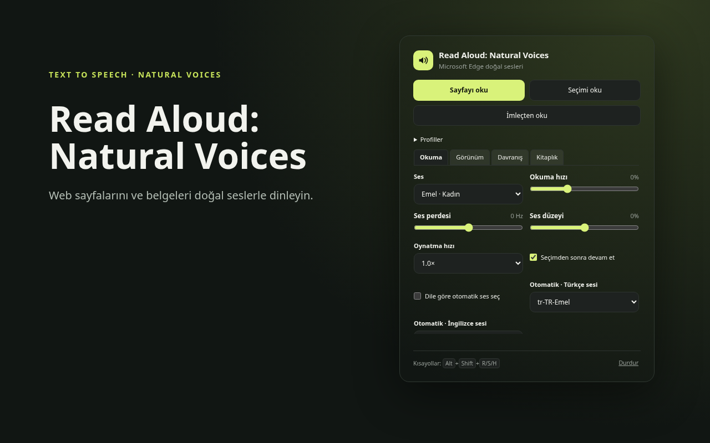
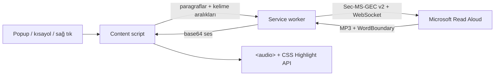

<div align="center">


# Read Aloud: Natural Voices

**Doğal seslerle metinleri dinleyin.**

Edge'in doğal neural sesleriyle sayfaları, seçimleri ve imlecin olduğu yeri okuyan
Manifest V3 eklentisi. API anahtarı yok, hesap yok, kurulum derdi yok.

[](manifest.json)
[](LICENSE)
[](manifest.json)
[](https://www.microsoft.com/edge)
[](#)

[Kurulum](#kurulum) · [Kullanım](#kullanım) · [Nasıl çalışır?](#nasıl-çalışır) · [Kelime vurgusu](#kelime-vurgusu) · [Gizlilik](#gizlilik) · [Sorun giderme](#sorun-giderme)

</div>

---

<p align="center">
  
</p>

## Neden Read Aloud: Natural Voices?

Read Aloud: Natural Voices, Edge'in Read Aloud servisini kullanarak web sayfalarını ve belgeleri doğal seslerle okur:

- Aynı Microsoft neural sesleri (Türkçe **Emel** ve **Ahmet** dahil)
- Sayfa metnini **paragraf paragraf** okuma
- Okunan **kelimeyi makalenin kendi metninde** vurgulama
- İmleçten, seçimden veya sayfanın tamamından başlatma
- Oynatıcıda canlı hız, duraklatma, önceki/sonraki paragraf

> [!NOTE]
> Bu eklenti Microsoft'un resmî olmayan Read Aloud uç noktasını kullanır.
> Microsoft ile bağlantılı değildir. Uç nokta veya token algoritması
> değişebilir; böyle durumlarda güncelleme gerekir.

## Öne çıkanlar

| Alan | Ne yapar |
| --- | --- |
| **Sesler** | 300'den fazla Microsoft neural sesi; Türkçe Emel ve Ahmet hazır |
| **Okuma** | Sayfanın tamamı, seçili metin veya imlecin bulunduğu cümle |
| **Vurgu** | Paragraf + kelime vurgusu; yumuşak geçişli, tema duyarlı ışık halkası |
| **Takip** | Metin görünümden çıkınca otomatik kaydırma; elle kaydırınca duraklar, **Okumaya dön** ile devam eder |
| **Akış** | Paragraf buffer'ı + bir sonraki paragrafı önceden hazırlama; dev MP3 yok |
| **Oynatıcı** | Sayfanın üstünde, içeriği aşağı iten oynatıcı; canlı hız (0.75×–2×), ses/hız/düzey ayarları, duraklat, önceki/sonraki paragraf, durdur |
| **Erişim** | Klavye kısayolları, sağ tık menüsü ve popup |
| **Gizlilik** | Geliştiriciye veri gitmez; ayarlar yalnızca `chrome.storage.local` içinde |
| **Kurulum** | Derleme yok, bağımlılık yok; klasörü Edge'e yükle veya ZIP kullan |

## Ekran görüntüleri

<table>
  <tr>
    <td width="62%" valign="top">
      
      <br />
      <sub>Gerçek bir blog yazısında paragraf ve kelime vurgusu, üst oynatıcı.</sub>
    </td>
    <td width="38%" valign="top">
      
      <br />
      <sub>Popuptan ses, hız ve seçimden devam ayarları.</sub>
    </td>
  </tr>
</table>

## Kurulum

### Gereksinimler

- **Microsoft Edge 116+**
- İnternet bağlantısı (ses sentezi Microsoft servisinde yapılır)
- Edge'de **Geliştirici modu** (paketlenmemiş yükleme için)

### Yöntem 1 — Kaynak klasörden (önerilen)

```bash
git clone https://github.com/baturkacamak/read-aloud-natural-voices.git
cd read-aloud-natural-voices
```

1. `edge://extensions` adresini açın.
2. Sağ alttan **Geliştirici modu**nu açın.
3. **Paketlenmemiş öğe yükle** ile bu klasörü seçin.
4. Araç çubuğundaki **Read Aloud: Natural Voices** simgesini sabitleyin.

### Yöntem 2 — Hazır ZIP

[Son sürümü indirin](https://github.com/baturkacamak/read-aloud-natural-voices/releases/latest),
ZIP'i açın ve `edge://extensions` → **Paketlenmemiş öğe yükle** ile çıkan klasörü
seçin.

> [!IMPORTANT]
> Eklentiyi güncelledikten sonra `edge://extensions` sayfasında **Yenile**'ye
> basın ve okumak istediğiniz sayfayı **F5** ile yenileyin. İçerik betiği
> değişiklikleri ancak sayfa yenilenince devreye girer.

## Kullanım

| Eylem | Yol |
| --- | --- |
| **Sayfayı oku** | Simge → **Sayfayı oku** · `Alt+Shift+R` |
| **Seçimi oku** | Metni seçin → sağ tık → **Seçimi sesli oku** · `Alt+Shift+S` |
| **İmleçten oku** | İmleci metne koyun → sağ tık → **Buradan sesli oku** · `Alt+Shift+H` · Simge → **İmleçten oku** |
| **Oynat / duraklat** | `Alt+Shift+Space` · Oynatıcıdaki ▶ / ❚❚ |
| **Durdur** | Oynatıcıdaki ✕ · Simge → **Durdur** |
| **Paragraf atla** | Oynatıcıdaki ⏮ / ⏭ |
| **Hız** | Oynatıcıdaki `1.0×` düğmesi (0.75×–2×) |
| **Ses ve okuma ayarları** | Oynatıcıdaki ⚙ düğmesi (ses, okuma hızı, ses düzeyi) |

### Üst oynatıcı ve ayarlar

Oynatıcı, sayfanın HTML katmanının üzerinde, ekranın en üstüne sabitlenmiş
bir şerit olarak açılır ve kaydırma sırasında görünür kalır. Şerit için
sayfanın üstünde alan ayrılır; içerik ve sabit üst menüler (WordPress yönetim
çubuğu dahil) aşağı itilir. Okuma durdurulunca ayrılan alan kaldırılır ve
menüler eski konumlarına döner.

Oynatıcı, ekran genişliğini kaplayan bir şerittir. ⚙ düğmesi; ses seçimi,
okuma hızı ve ses düzeyi ayarlarını şeridin altında açar. Ayarlar açılınca
ayrılan alan büyür ve içerik aşağı itilir; kapanınca alan geri verilir.
Değişiklikler anında uygulanır ve popup ile aynı `chrome.storage.local`
kaydına yazılır.

Okuma sürerken sayfadaki bir kelimeye **sol tıklamak**, okumayı doğrudan o
kelimeden devam ettirir. Duraklatılmış okuma da bu şekilde devam ettirilebilir.
Bağlantılar, düğmeler, düzenlenebilir alanlar ve hariç tutulan bölgeler kendi
işlevlerini korur; metni sürükleyerek seçmek veya boşluğa tıklamak okuma konumunu değiştirmez.
Ayarlar tıklamayla kapandığında sayfa yer değiştirse bile başlangıçta tıklanan
kelime kullanılır.

### Okuma, görünüm ve davranış ayarları

Üst çubuğun ⚙ paneli ve popup aynı **Okuma · Görünüm · Davranış · Kitaplık** sekmelerini
kullanır. Ayarlar yerel olarak kaydedilir ve açık arayüzler arasında eşzamanlanır.

| Sekme | Ayarlar |
| --- | --- |
| **Okuma** | Ses, okuma hızı, ses perdesi (−50…+50 Hz), ses düzeyi, oynatma hızı (0.5×–2×), seçimden sonra devam etme |
| **Görünüm** | Beş tema, kelime/paragraf/ikisi/kapalı vurgu, tema rengi veya özel renk, vurgu yoğunluğu, ışık halkası yoğunluğu |
| **Davranış** | Otomatik takip, yumuşak/anında kaydırma, paragraflar arasında 0–3 saniye bekleme, uyku zamanlayıcısı, konumu hatırlama |
| **Kitaplık** | Kaldığın yerden devam, yer imleri, okuma listesi, okunmayacak alanlar, telaffuz sözlüğü, odak görünümü ve MP3 indirme |

Vurgu ve takip ayarları sesi yeniden başlatmaz. Ses, okuma hızı, perde veya
ses düzeyi değiştirildiğinde mevcut paragraf yeni ayarla başlar; duraklatma ve
takip durumu korunur. Paragraf arası bekleme de oynatma duraklatıldığında bekler.
Uzun bir paragraf birden çok ses parçasına bölünse bile bekleme yalnızca
paragrafın sonunda uygulanır.

**Uyku zamanlayıcısı**, okuma başladıktan sonra 10/20/30/60 dakika, özel süre
(1–180 dakika) veya **bu paragraf bitince** seçenekleriyle kurulabilir. Süreye
bağlı zamanlayıcı duraklatma sırasında da işler; ses/perde değişikliği süreyi
sıfırlamaz. Paneldeki sayaç kalan süreyi gösterir. **Kapalı → Uygula** ile
okumayı durdurmadan iptal edilebilir. Okuma bitince veya durdurulunca temizlenir.

**Profiller** bölümünde Makale, Ders ve Gece hazır ayarları vardır. Mevcut ses,
hız, vurgu, davranış ve tema tercihlerinizi adlandırarak en fazla 20 profil
kaydedebilir, uygulayabilir veya silebilirsiniz. Aynı adla kaydetmek mevcut
profili günceller. Uyku zamanlayıcısı profillere dahil edilmez.

### Konum, yer imleri ve gelişmiş okuma araçları

Kitaplık paneli dört alt sekmeye ayrılır: **Kayıtlar** (başlıklar, yer imleri,
okuma listesi), **Belgeler** (dosya açma, çevrimdışı kayıtlar, MP3),
**İstatistikler** (dinleme süresi ve hedef), **Yönetim** (hariç tutulan alanlar,
sözlük, site kuralları, eşitleme ve yedekleme). Devam et ve Yer imi ekle tüm
alt sekmelerin üstünde kalır. Alt sekmeler mevcut temanın sekme stilini kullanır;
sol/sağ ok, Home ve End ile klavyeden seçilebilir. Gruplar arasında geçerken
arama, açık bölümler ve kaydedilmemiş not taslakları korunur.

- **Kaldığım yerden devam et:** Konum yaklaşık beş saniyede bir, duraklatırken ve
  durdururken kaydedilir. Kitaplık sekmesinden aynı yazıya geri dönülebilir.
  Metin değişmişse kayıtlı paragraf bulunamadığı bildirilir. Davranış sekmesindeki
  **Okuma konumunu hatırla** seçeneğiyle yeni konum kaydı kapatılır.
- **Yer imleri:** Oynatıcıdaki ★ veya Kitaplık → Yer imi ekle mevcut paragrafı
  ve ses konumunu saklar. Kitaplıktaki Aç/Sil düğmeleriyle yönetilir.
- **Zaman çizgisi:** −10 sn / +10 sn, oynatma hızına göre on saniye geri/ileri
  gider. Sürgüyü hareket ettirirken okuma geçici olarak durur; kelime vurgusu
  ve otomatik takip seçilen konumu canlı gösterir. Bırakınca seçilen kelimeden
  devam eder; önceden duraklatılmış okuma duraklatılmış kalır. Sürükleme sırasında
  her hareket için ses üretilmez. Escape veya iptal edilen dokunma hareketi önceki
  konuma döner. Henüz üretilmemiş seslerde kelime konumu ve süreler
  tahminidir; kalan süredeki `~` işareti bunu belirtir. Paragraf arası beklemeler
  süre tahminine dahil değildir.
- **Okuma listesi:** Kitaplık → Kayıtlar → Okuma listesi bölümüne bu sayfayı veya bir
  HTTP/HTTPS adresini ekleyin; ↑/↓ ile sıralayın. Sırayı başlat tek bir sekmede
  yazıları art arda okur. Hatalı/boş sayfa atlanır; yüklemede 60 saniye zaman
  aşımı vardır. Sırayı durdur veya okuma sekmesini kapatmak sırayı durdurur.
  Yeniden başlatmak listeyi baştan okur; tarayıcı yeniden açılınca otomatik başlamaz.
- **Okunmayacak alanlar:** Kitaplık → Yönetim bölümünden alan seçimini açın, sayfada okumadan
  çıkarılacak bölgeye tıklayın; Esc iptal eder. Kural aynı adres için saklanır
  ve Kitaplıktan kaldırılabilir. Sayfanın yapısı değişirse alanı yeniden seçin.
- **Telaffuz sözlüğü:** Kitaplık → Yönetim → Telaffuz sözlüğü düzenleyicisine her satıra `API = ey pi ay`
  gibi bir kayıt yazıp kaydedin. En fazla 200 kural desteklenir. Seslendirme
  değişirken sayfadaki özgün sözcük vurgulanmaya devam eder.
- **Dile göre ses:** Okuma sekmesinde otomatik ses seçimini açıp Türkçe ve
  İngilizce için tercihlerinizi seçin. Paragrafın `lang` bilgisi önceliklidir;
  yoksa metin üzerinden dil tahmini yapılır. Diğer dillerde ses kataloğundan
  uygun bir ses seçilir; kısa veya karma metinlerde tahmin yanılabilir.
- **Odak görünümü:** Oynatıcıdaki Odak düğmesi metni sade bir okuma alanında
  gösterir. Paragrafa tıklamak veya Enter o noktadan okumayı başlatır.
  Görünüm sekmesinden 16–36 px yazı boyutu ve tema/kâğıt/koyu arka plan seçilir.
- **MP3 indir:** Kitaplık → Belgeler bölümünden mevcut okuma metni tek MP3 olarak indirilebilir.
  Okuma başlamadıysa sayfa metni kullanılır. Ses, perde, ses düzeyi, sözlük ve
  otomatik dil ayarları uygulanır; oynatma hızı ve paragraf arası bekleme dosyaya
  işlenmez. Ses Microsoft servisinde yeniden hazırlanır; internet gerekir.
  İlerleme ve iptal Kitaplıkta gösterilir. Hazırlık boyunca oynatma duraklar;
  işlem bitince önceki durumu korunur. Sekmeyi kapatmak hazırlığı iptal eder.

Konumlar (son 100 adres), yer imleri (300), liste (50 yazı), hariç tutma
kuralları ve telaffuz sözlüğü yalnızca tarayıcı profilinde saklanır. Ses
indirmeleri tarayıcının normal indirme ayarlarını kullanır.

### Site ayarları, çalışma araçları ve belgeler

- **Siteye özel ayarlar:** Kitaplık → Yönetim → Siteye özel ayarlar → Bu sitenin mevcut
  ayarlarını kaydet. Ses, hız, tema, renk modu, odak tercihleri ve mevcut
  hariç tutma kuralları aynı site adresinde otomatik uygulanır. Özel ayarlar
  etkinken panelde yaptığınız değişiklikler o siteye yazılır; diğer sitelerin
  genel ayarları değişmez. Genel ayarlara dön ile kural kaldırılır. Eşleşme
  protokol + alan adı + port üzerinden yapılır; alt alan adları ayrı sayılır.
- **Notlar ve etiketler:** Yer imini veya liste öğesini açıp not ve virgülle
  ayrılmış etiketler ekleyin, ardından kaydedin. Kitaplık araması başlık,
  adres, not ve etiketlerde arar. Notlar 3000 karakter, etiketler kayıt başına
  12 adetle sınırlıdır.
- **Tekrar / A–B döngüsü:** Oynatıcının altındaki Tekrar menüsü mevcut cümle
  veya paragrafın başına döner; cümle/paragraf döngüsü de kurulabilir. A ve B
  noktalarını ses oynarken veya duraklatıp zaman çizgisinde ilerleyerek
  işaretleyin; ardından A–B döngüsünü açın. Döngüyü kapat normal akışa döner.
  Döngüler oturuma aittir; uyku zamanlayıcısı çalışmaya devam eder.
- **Gelişmiş odak:** Görünüm sekmesinden serif/sans serif/eş aralıklı yazı
  tipi, satır aralığı (1.2–2.6), metin genişliği (400–1200 px) ve kenar boşluğu
  (8–60 px) seçilir. Aynı tercihler belge okuyucusunda da kullanılır.
- **Çevrimdışı kitaplık:** Kitaplık → Belgeler → Belgeler ve çevrimdışı kitaplık → Bu
  okumayı çevrimdışı sakla. Mevcut okuma metni, sesi ve kelime zamanları
  hazırlanır; kayıt tamamlanınca Aç ile internet olmadan dinlenebilir.
  Hazırlama internet gerektirir. Kayıttaki ses, perde ve telaffuz sabittir;
  dinlerken oynatma hızı ve görünüm değiştirilebilir. İptal/sekme kapatma
  yarım ses parçalarını temizler. Yerel belge ve sesler için toplam 250 MB
  sınırı vardır; kayıtlar Kitaplıktaki Sil düğmesiyle kaldırılır.
- **Yedekleme:** Kitaplık → Yönetim → Yedekleme / geri yükleme → Yedeği indir JSON
  üretir. Yedeği birleştir geçerli bir yedeği mevcut kayıtlarla birleştirir
  ve yedekteki ayarları uygular. Profiller, sözlük, konumlar, notlar,
  etiketler ve site kuralları dahildir. Çalışan kuyruk ve zamanlayıcı
  aktarılmaz. Ses ve belge dosyaları JSON yedeğine dahil değildir; belge
  yer imleri için özgün dosyayı yeni tarayıcıda yeniden açmak gerekir.
- **PDF / EPUB:** Kitaplık → Belgeler → Belgeler ve çevrimdışı kitaplık → PDF / EPUB / görsel aç
  ayrı belge okuyucusunu açar. Dosya bu cihazda metne dönüştürülür; sayfa veya
  bölüm seçicisiyle gezinilebilir. EPUB kitap sırasını, PDF metin katmanını
  kullanır. Orijinal sayfa tasarımı yerine sade metin gösterilir. Sesli oku,
  kaldığın yerden devam, kelimeye tıklayarak başlatma ve yer imleri çalışır.
  Dosya başına en fazla 50 MB, PDF için 1000 sayfa/5 milyon karakter ve EPUB
  için 20 MB çıkarılmış metin/5000 bölüm sınırı vardır. DRM korumalı EPUB desteği yoktur. Parolalı PDF parolası bellekte kullanılır,
  kaydedilmez. Belge metni yerelde saklanır; yalnızca seslendirme veya ses
  hazırlama seçilince metin Microsoft servisine gönderilir.

- **Bölümler / seçerek oku:** Oynatıcıdaki Bölümler düğmesi Kitaplık menüsünü açar; okunan içeriği sayfa
  başlıklarına göre böler. Buradan oku ile bir başlığa atlayın; kutuları seçip
  Seçili bölümleri oku ile yalnızca istediğiniz bölümleri dinleyin. Başlıkları
  yenile tüm sayfayı yeniden tarar. Başlıksız metin Başlangıç altında görünür.
- **Sistem medya kontrolleri:** Desteklenen tarayıcı/işletim sisteminde medya
  tuşları ve sistem medya paneli oynat/duraklat/durdur, önceki/sonraki metin
  parçası ve zaman atlamayı yönetir. Başlık olarak mevcut sayfa gösterilir.
  Durdurunca uzantının medya eylemleri kaldırılır. İşletim sistemi panelinin
  varlığı ve hangi tuşları gösterdiği platforma bağlıdır.
- **Akıllı yer imi onarımı:** Yeni konum kayıtlarında hedef kelimenin çevresindeki
  metin de tutulur. Paragrafın önüne içerik eklendiğinde, yeri değiştiğinde veya
  boşluklar/paragraf sınırları değiştiğinde metin yeniden aranır. Birden çok eşit
  eşleşme varsa yanlış yere atlamak yerine konumu yeniden seçmeniz istenir.
  Hedef metin tamamen silindiyse otomatik onarım yapılamaz.
- **Dinleme istatistikleri ve hedef:** Kitaplık → İstatistikler bölümünde bugün ve bu haftanın dinleme
  süresi, tamamlanan farklı yazılar ve haftalık dakika hedefi bulunur. Son
  365 gün cihazda tutulur; duraklama ve ses hazırlama süresi sayılmaz. Süre
  gerçek çalma sırasındaki duvar saatinden yaklaşık hesaplanır, hızla atlanan
  ses süresi eklenmez. Hedef 0 olursa ilerleme göstergesi gizlenir. İstatistikleri
  sil düğmesi geçmişi temizler; kayıtlar eşitlenmez ve JSON yedeğine girmez.
- **Cihazlar arası eşitleme:** Kitaplık → Yönetim bölümünden açılır; başlangıçta kapalıdır.
  Aynı uzantının aynı kimlikle yüklü olduğu ve uzantı senkronizasyonunun açık
  olduğu aynı tarayıcı hesabındaki cihazları kullanın. Web konumları, yer imleri,
  notlar/etiketler, genel tercihler ve profiller tarayıcının `storage.sync`
  alanına aktarılır. Belge/ses dosyaları, belge yer imleri, site kuralları,
  hariç tutmalar, kuyruk ve istatistikler yerel kalır. Değişiklikler yaklaşık
  bir dakika içinde gönderilir; Şimdi eşitle elle tetikler. Konumlar ve yer
  imleri zaman damgasıyla birleştirilir; genel tercihlerde son değişiklik
  kullanılır. Diğer cihazda aynı yazıyı açıp Kaldığım yerden devam et düğmesini
  kullanabilirsiniz. Silinen kayıtlar için sınırlı bir silme günlüğü tutulur (1000 yer
  imi, 500 konum). Sıkıştırılmış veri yaklaşık 95 KB'ı aşarsa panel hata gösterir
  ve yerel veriler korunur; JSON yedeği kullanılabilir. Hesaptaki kopyayı sil ve
  kapat yerel kayıtları silmez. Başka bir cihazda eşitleme açık kalırsa yeniden
  kopya yükleyebilir; hesabı tamamen temizlemek için önce diğer cihazlarda da
  kapatın. Tarayıcının hesap sunucuları arasındaki aktarım süresi uzantının
  kontrolünde değildir.
- **Yerel OCR:** Belge okuyucusunda PNG/JPEG/WebP/BMP görsel seçin veya taranmış
  PDF için OCR kutusunu açıp dosyayı yeniden seçin. Türkçe, İngilizce veya her
  iki dil seçilebilir. PDF'de metin katmanı olan sayfalar doğrudan ayrıştırılır;
  metinsiz sayfalar tanınır. OCR açıkken en fazla 20 PDF sayfası işlenir; büyük
  belgelerde ilk/son sayfa aralığını daraltın. Görseller 40 megapikselle sınırlıdır;
  tanımada en fazla 12 megapiksele ölçeklenir. Motor ve dil modelleri uzantıda
  paketlidir; internet olmadan çalışır. İptal önceki belgeyi korur. OCR hatalı
  harfler üretebilir; belge özgün tasarım yerine tanınan metin olarak kaydedilir.

PDF.js, fflate ve Tesseract.js, lisanslarıyla birlikte `src/vendor` içinde paketlenmiştir.
Çalışma sırasında CDN kullanılmaz. Geliştirmede `npm ci` ardından
`npm run vendor:readers` bu dosyaları sabitlenmiş sürümlerden yeniden üretir.

### Görünüm temaları

Popup'taki veya üst çubuğun ⚙ ayarlarındaki **Görünüm · Tema** menüsünden
**Modern**, **Windows 95**, **Windows 98**, **Windows XP** ve **Windows 7**
arasında geçiş yapabilirsiniz. Seçim anında tüm açık uzantı arayüzlerine
uygulanır, yerel olarak kaydedilir ve sonraki açılışlarda korunur. Tema değişimi
okumayı yeniden başlatmaz; duraklatma, paragraf ve takip konumu korunur.
Tema geçişlerinde eski ve yeni görünüm 320 ms içinde yumuşakça birbirine
geçer; çubuğun yüksekliği ve sayfada ayrılan alan birlikte hareket eder.
Sistemde **hareketi azalt** tercihi açıksa geçişler anında uygulanır.
Açılır seçim listeleri için her temanın ayrı davranışı vardır: Windows 95
anında açılır; Windows 98, XP ve 7 efektler açık senaryosundaki kayarak açılmayı
kullanır. Modern kısa bir saydamlık/konum geçişi kullanır. Eski Windows
kaynakları XP ve 7 için de aynı slide-open efektini tarif ettiğinden bu ikisine
farklı efektler uydurulmamıştır. Animasyon süreleri uygulama tercihidir;
özgün sistemlerden ölçülmüş değerler değildir. Hareketi azalt tercihi tüm liste
animasyonlarını kapatır. [Kaynaklar ve uyarlama notları](docs/dropdown-motion.md).

**Görünüm → Açık / koyu görünüm** alanında **Özgün görünüm**, **Açık** ve
**Koyu** seçenekleri vardır. Özgün görünüm Windows temalarının mevcut açık
paletini ve Modern'in mevcut davranışını korur. Koyu seçenek, Windows 95/98,
XP ve 7'nin pencere biçimlerini koruyan uyarlanmış koyu paletler kullanır.
Başlık, panel, alanlar, onay kutuları, açılır listeler ve kaydırma çubukları
birlikte uyarlanır; sayfanın kendi renkleri değiştirilmez. Renk modu tema
geçişi gibi yumuşakça uygulanır, arayüzler arasında eşzamanlanır, yerel olarak
saklanır ve kaydedilen profillere dahil edilir.

Temalar; düğmeleri, başlıkları, alanları, kaydırıcıları ve okuma vurgusunu
birlikte değiştirir. Modern mevcut görünümü korur. Windows 95 düz lacivert,
Windows 98 geçişli başlıklar kullanır. XP teması; tam genişlikte Luna başlığı,
mavi pencere çerçevesi, başlık içindeki kırmızı kapatma düğmesi ve yeşil
oynatma/kaydırıcı kontrolleri kullanır. Windows 7 teması ise Aero benzeri cam
çerçeve, parlayan başlık, üst kenara birleşen geniş kapatma düğmesi ve parlak
komut düğmeleri içerir. Her ikisinde de kontroller başlığın altına yerleşir;
popup aynı dönemin pencere ve form ölçülerini kullanır. Windows 95/98
temalarında tam genişlikte klasik başlık,
kompakt araç çubuğu ve 98.css projesinden alınan piksel yazı tipleri kullanılır.

Katlanır bölümler de temaya uyarlanır: Windows 95/98'de kabartmalı +/− kutuları,
XP'de mavi başlık ve sağda çift ok, Windows 7'de ince dönen üçgen bulunur.
Açık/koyu paletleri, odak çerçevesi ve klavyeyle açma/kapama korunur. Modern
mevcut açılır bölüm görünümünü kullanır.
Stiller ve yazı tipleri uzantıyla birlikte gelir; uzaktan CSS veya font indirilmez.
Açılır seçim listeleri ve scrollbarları da seçili temayı kullanır. Sesler dil
gruplarıyla gösterilir; ok tuşları, Home/End, Page Up/Down ve yazarak arama
desteklenir. Enter seçimi uygular, Escape değişikliği iptal eder.

HTML class'ları ortaktır. `src/themes.js` içindeki tema katmanı, popup'ın
`body` ve oynatıcının Shadow DOM içindeki `.wrap` kapsayıcısına verilen
`data-theme` değerine göre görünümü uygular. Tema stilleri ziyaret edilen
sayfanın kontrollerine yayılmaz. Temel stiller `base`, tema stilleri ise daha
öncelikli `themes` CSS katmanındadır; modern kontrollerin seçici önceliği klasik
tema görünümünü ezemez. Klasik tema kaynaklarının lisansı `src/vendor/98.css/LICENSE`
dosyasındadır.

### İmleçten okuma

1. Okumak istediğiniz paragrafın içine tıklayıp imleci yerleştirin.
2. Sağ tık → **Buradan sesli oku** veya `Alt+Shift+H`.

Okuma, imlecin bulunduğu **cümlenin başından** başlar ve sayfanın devamına
geçer. "Seçimi oku" bir metin seçili değilse otomatik olarak bu davranışa düşer.

### Seçimden devam

"Seçimi oku" varsayılan olarak seçimin bittiği yerden sayfanın devamını okur.
Yalnızca seçimi okumak istiyorsanız popup'taki **Seçimden sonra devam et**
kutusunu kapatın.

### Elle kaydırma ve takip

Okuma sürerken sayfayı elle kaydırırsanız otomatik takip duraklar; oynatıcıda
**Okumaya dön** düğmesi görünür. Bu düğme sizi okunan kelimeye geri getirir.
Elle müdahale etmediğiniz sürece metin görünümden çıktıkça otomatik kaydırma
devam eder.

> Tarayıcılar en fazla **4 varsayılan kısayola** izin verir. Bu yüzden
> **Durdur**'un varsayılan tuşu yok; `edge://extensions/shortcuts` üzerinden
> dilediğiniz tuşu atayabilirsiniz.

## Nasıl çalışır?



### Parça parça okuma, tek dev dosya değil

- Metin, **en fazla ~900 karakterlik** parçalara bölünür; genelde her paragraf
  ayrı bir parçadır.
- Her parça için Microsoft'a ayrı bir SSML isteği gider; gelen MP3 parçaları o
  parça için bellekte birleştirilir.
- Parça çalınırken **bir sonraki parça önceden hazırlanır**. Böylece paragraflar
  arasında genelde kesinti olmaz.
- Aynı anda bellekte en fazla **çalan + sonraki** parça bulunur; 10 dakikalık
  yazı için tek bir 10 dakikalık dosya üretilmez.

### Dosya haritası

| Dosya | Görev |
| --- | --- |
| `src/drm.js` | `Sec-MS-GEC` v2 token üretimi (CS64 + SHA-256) |
| `src/tts.js` | WebSocket protokolü, SSML, MP3 ve kelime sınırları |
| `src/i18n.js` | Ortak sözlük çalışma zamanı, dil seçimi ve `data-i18n` uygulaması |
| `locales/` | JSON çeviri kaynakları (82 dil, isteğe bağlı yüklenir) |
| `src/locales/base.js` | Temel dil kataloğu + dil listesi (üretilen) |
| `_locales/` | Manifest metinleri (üretilen) |
| `l10n.config.json` | Localization Toolkit yapılandırması |
| `scripts/l10n-translate.mjs` | Toplu Google Translate çeviri hattı |
| `src/background.js` | Mesaj yönlendirme, ses listesi önbelleği, menüler |
| `src/library.js` | Yerel kitaplık, kuyruk verisi, telaffuz eşlemesi ve kitaplık paneli |
| `src/insights.js` | Dinleme istatistikleri ve isteğe bağlı hesap eşitlemesi |
| `src/ocr.js` | Yerel Tesseract işçisi, dil modelleri ve iptal yönetimi |
| `src/experience.js` | Zaman çizgisi, konum/yer imi, odak, alan seçimi ve MP3 dışa aktarma |
| `src/settings.js` | Ortak ayar şeması, sekmeli panel, profiller ve arayüzler arası eşzamanlama |
| `src/themes.js` | Ortak tema stilleri, tema seçimi, kalıcılık ve arayüzler arası eşzamanlama |
| `src/content.js` | Metin çıkarma, parçalama, oynatma kuyruğu, vurgu, oynatıcı |
| `src/popup.*` | Ses / hız / ses düzeyi / seçimden devam arayüzü |
| `manifest.json` | Manifest V3 tanımı, izinler, kısayollar |
| `scripts/package.py` | Mağaza ZIP'i üretir |

## Kelime vurgusu

<p align="center">
  
</p>

Vurgu, sayfanın DOM'unu değiştirmeden **CSS Custom Highlight API** ile yapılır:

- Metin ve DOM aralıkları **aynı kaynaktan** üretilir. `&shy;`, zero-width
  karakterler, `<br>`, blok sınırları ve `text-transform` farkları eşleşmeyi
  bozmaz.
- Kelimenin üzerindeki dolgu `::highlight(edge-ra-word)` ile çizilir.
- Dolgunun etrafında, sayfa temasına göre açık/koyu ayarlanan **yuvarlak bir
  ışık halkası** bulunur. Bu katman `pointer-events: none` olduğu için metni
  örtmez, seçimi engellemez.
- Aynı satırda kelimeler arasında yumuşak yatay kayma; **yeni satır/paragrafta**
  kutu uçmaz, yeni kelimenin üzerine hafif fade + scale ile oturur.
- Otomatik kaydırma kelime bazlıdır: kelime görünür alandaysa scroll yapılmaz;
  değilse yalnızca gerektiği kadar kaydırılır.

### Metin çıkarma kuralları

- Önce `article`, `main` veya `[role="main"]` kapsamı aranır.
- Paragraflar, başlıklar, listeler, alıntılar, tablo hücreleri ve anlamlı
  `div`/`section` blokları okunur.
- **Link yoğunluğu %60'ın üzerinde** olan bloklar (yan menü, konu listesi,
  navigasyon) atlanır.
- Bir kapsayıcının alt blokları metnin **%80'inden fazlasını** oluşturuyorsa
  kapsayıcı değil, alt paragraflar okunur; böylece her paragraf kendi vurgu ve
  scroll hedefi olur.
- Bu kurallar özellikle Astra/WordPress temalarındaki `ast-no-sidebar` gibi
  yanıltıcı sınıf adlarına karşı test edilmiştir.

## Gizlilik

- Geliştirici **hiçbir veri toplamaz**; analitik, reklam veya telemetri yoktur.
- Okunan metin, ses üretimi için Microsoft'un Read Aloud servisine gönderilir.
- Ses, hız, ses düzeyi ve devam ayarları yalnızca `chrome.storage.local`
  içinde tutulur.
- Ses listesi 7 gün boyunca yerel olarak önbelleğe alınır.

Ayrıntılar: [PRIVACY.md](PRIVACY.md)

## Geliştirme

Bağımlılık veya derleme adımı yoktur; dosyalar doğrudan Edge'e yüklenir.

```bash
# sözdizimi kontrolleri
node --check src/content.js
node --check src/popup.js
node --input-type=module --check < src/background.js
node --input-type=module --check < src/tts.js
node --input-type=module --check < src/drm.js

# mağaza ZIP'i
python3 scripts/package.py
```

### Token üretimini doğrulama

`src/drm.js` içindeki v2 token üretimi, Python `edge-tts` referansıyla birebir
aynı sonucu verir:

```bash
pip install edge-tts
python - <<'PY'
from edge_tts.drm import generate_sec_ms_gec_v2
print(generate_sec_ms_gec_v2(1761830000))
PY
```

### Testler

Çalışma zamanı için bağımlılık yoktur; testler Edge'i CDP üzerinden sürer ve
tek geliştirme bağımlılığı olarak `ws` kullanır.

```bash
npm install
npm test
```

Canlı sürgü önizlemesi `SCRUB_ONLY=1 npm test` ile ayrı çalıştırılabilir; gerçek fare sürüklemesi de test edilir.

Hız regresyonunu tek başına çalıştırmak için `SPEED_ONLY=1 npm test` kullanılır.
[Yeniden üretme ve neden](docs/playback-speed.md) belgesinde önceki/sonraki ölçümler bulunur.

Testler şunları doğrular:

- Oynatma hızının yeni ses parçalarında, duraklatıp devam etmede ve atlamada korunması; gerçek ses hızı ve geçen süreyle doğrulama

- Eski bir eklenti sürümünden kalan oynatıcı/highlight katmanlarının temizlenmesi
- Aynı anda ikinci bir `#sesli-oku-spotlight` oluşmaması
- Vurgunun kelime dikdörtgeniyle hizalanması (7 px yatay / 5 px dikey padding)
- Gerçek fare tekerleği kaydırmasının otomatik takibi durdurması
- Takip dururken yeni kelimenin sayfayı geri çekmemesi
- Takip dururken vurgunun kelimeye yapışık kalması (animasyonsuz)
- **Okumaya dön** düğmesinin okunan kelimeyi yeniden ekranın üst kısmına alması
- Sabit alt panellerin (sohbet kutusu, çerez çubuğu vb.) metni kapatmaması
- Gemini/ChatGPT gibi **kendi iç scroll konteynerini** kullanan sayfalarda
  okumanın bu konteyneri kaydırması
- **Okumaya dön** düğmesinin takibi yeniden başlatması
- Oynatıcının HTML üzerinde sabit bir üst şerit olarak içeriği aşağı
  itmesi ve kaydırma sırasında ekranın tepesinde sabit kalması
- Üst oynatıcıdaki ⚙ ayarlar panelinin açılması ve ses listesini içermesi
- Ayarlar açıkken ardışık kelimelerde kaydırmanın aşağı-yukarı salınmaması;
  WordPress yönetim çubuğu, dar okuma alanı ve yumuşak kaydırma davranışı
- Beş görünüm temasının popup ve üst çubukta eşzamanlanması, kaydedilmesi,
  dar ekrana sığması ve tema değişiminin okuma durumunu koruması
- Açık/koyu paletlerin beş temada iki arayüze uygulanması, erişilebilir seçim
  eşzamanlaması, profil ve yeniden açılışta korunması, yumuşak geçişler
- Site ayarlarının diğer sitelere taşmaması, not/etiket araması, yedek
  doğrulama ve geri yükleme; tekrar sesi önbelleği ve A–B döngüsü
- Bağlantı kapalıyken hazır sesin sentez isteği olmadan oynatılması, iptalde
  yarım kayıtların temizlenmesi, gerçek PDF/EPUB ayrıştırma ve bölüm sırası
- Konum/yer imi, zaman çizgisiyle paragraflar arası gezinme, telaffuz ve özgün
  kelime eşlemesi, otomatik Türkçe/İngilizce ses, odak görünümü ve alan hariç tutma
- Üç ses parçasının tek MP3 olarak indirilmesi ve tarayıcıda çözümlenmesi,
  iptal edilen indirmede geç gelen yanıtın dosya oluşturmaması
- Okuma listesinin boş sayfayı atlayıp iki yazıyı ardışık tamamlaması
- Okuma durdurulduğunda paragraf/kelime vurgusunun ve ışık halkasının
  (eski bir içerik betiğinden kalan kopyalar dahil) tamamen kaldırılması

Test sayfası `?sesliOkuTest=1` ile açılır; test hook'u yalnızca bu modda
etkindir.

### Proje yapısı

```text
read-aloud-natural-voices/
├── manifest.json
├── src/
│   ├── background.js
│   ├── content.js
│   ├── content.css
│   ├── reader.html / reader.js / reader.css
│   ├── vault.js
│   ├── tools.js
│   ├── experience.js
│   ├── library.js
│   ├── drm.js
│   ├── popup.html
│   ├── popup.css
│   ├── settings.js
│   ├── themes.js
│   ├── popup.js
│   └── tts.js
├── tests/
│   ├── fixture.html
│   ├── fixture.mp3
│   └── run.mjs
├── icons/
├── store/
│   ├── demo/index.html
│   └── screenshots/
├── scripts/package.py
├── package.json
├── PRIVACY.md
├── STORE.md
├── NOTICE
└── LICENSE
```

## Sorun giderme

<details>
<summary><strong>403 / "Microsoft ses servisi bağlantıyı reddetti"</strong></summary>

Microsoft, Ekim 2026'da eski v1 token'ı kapattı; servis artık v2 token istiyor.
Eklenti güncel v2 token üretir. Yine 403 alıyorsanız:

1. Edge'i güncelleyin.
2. Eklentiyi `edge://extensions` üzerinden yeniden yükleyin.
3. `src/drm.js` içindeki `EDGE_CHROMIUM_VERSION` değerini Edge sürümünüzle
   eşleştirin (yalnızca `2-` öneki doğrulanır).
4. Token algoritması değiştiyse [rany2/edge-tts](https://github.com/rany2/edge-tts)
   `src/edge_tts/drm.py` dosyasındaki güncel `generate_sec_ms_gec_v2`
   uygulamasını `src/drm.js`'e port edin.

</details>

<details>
<summary><strong>Okuma başlamıyor / "Okunacak metin bulunamadı"</strong></summary>

- Sayfayı yenileyin (F5); içerik betiği yeni yüklenmiş olabilir.
- `edge://`, PDF görüntüleyici ve mağaza sayfaları desteklenmez.
- Bazı siteler metni gölge DOM veya canvas içinde tutar; bu sayfalarda sayfa
  okuma çalışmaz.
- "İmleçten oku" için önce metnin içine tıklayıp imleci yerleştirin.

</details>

<details>
<summary><strong>"Oynatmak için ▶ düğmesine basın"</strong></summary>

Tarayıcı otomatik oynatmayı engelledi. Sayfadaki oynatıcıda bir kez ▶'a basın;
sonraki paragraflar kendiliğinden devam eder.

</details>

<details>
<summary><strong>Ses listesi boş</strong></summary>

Servis geçici olarak yanıt vermiyor olabilir. Eklenti, Türkçe ve birkaç
İngilizce sesi içeren yedek listeyle açılır.

</details>

<details>
<summary><strong>Uzun sayfalarda bellek</strong></summary>

Her paragrafın sesi yalnızca çalınırken bellekte tutulur; sonraki paragraf
önceden hazırlanır. Çok uzun sayfalarda birkaç MB kullanılabilir; yazının
tamamı tek dosya olarak tutulmaz.

</details>

## Sınırlamalar ve riskler

- **Resmî olmayan API.** Microsoft uç noktayı veya token algoritmasını
  değiştirebilir; bu durumda eklenti güncellemesi gerekir.
- Tarayıcı uyumluluğu kullanılan ses servisine bağlıdır. Edge dışındaki
  tarayıcılarda 403 hatası görülebilir; Chrome ve diğer tarayıcılar ayrıca
  test edilmelidir.
- İnternet bağlantısı gerekir; metin Microsoft sunucularına gönderilir.
- Tarayıcının yerleşik PDF görüntüleyicisinde ve canvas/gölge DOM içeriğinde doğrudan sayfa okuma desteklenmez. PDF ve görselleri yerel belge okuyucusunda açabilirsiniz. DRM korumalı belgeler desteklenmez.
- Eklenti henüz mağazada yayınlanmadı; kaynak klasörden veya ZIP'ten yüklenir.

> [!NOTE]
> Kaynakta görünen `TRUSTED_CLIENT_TOKEN`, Microsoft Edge'in istemci kodunda
> gömülü olan **herkese açık istemci kimliğidir**; kişisel bir API anahtarı
> değildir. Depoda gizli anahtar, `.env` dosyası veya kimlik bilgisi yoktur.

## Mağaza paketi

```bash
python3 scripts/package.py
# dist/read-aloud-natural-voices-<sürüm>.zip

### Browser Extension Toolkit release entegrasyonu

`browser-extension-toolkit.config.json`, masaüstü Toolkit uygulamasının sürüm ve
paket yollarını tanımlar. Sürüm `package.json`, `package-lock.json` ve
`manifest.json` dosyalarında aynı olmalıdır; Toolkit sürüm artırırken üçünü günceller.

`npm run build`, paketlenecek eklentiyi `dist/extension/` içine hazırlar.
Toolkit mağaza paketlerini `builds/` içine yazar. Eski
`python3 scripts/package.py` komutu da çalışmaya devam eder.

Toolkit uygulamasında proje klasörünü yükleyip **Refresh Project** düğmesine basın.
Sürüm ve sonraki sürüm görünmelidir. Mağazaya gönderim için Toolkit'in Store
Credentials ekranında Chrome Web Store kimlik bilgilerini ayrıca yapılandırın.
Firefox paketinin üretilmesi, Firefox çalışma zamanı uyumluluğunun doğrulandığı
anlamına gelmez; Firefox yayını öncesinde ayrıca tarayıcı testi gerekir.
```

Mağaza metinleri, izin gerekçeleri ve yayın kontrol listesi
[STORE.md](STORE.md); gizlilik politikası [PRIVACY.md](PRIVACY.md) içinde.
Ekran görüntüleri ve demo sayfası `store/` altındadır.

## Katkı

Issue ve pull request'ler açıktır. Büyük değişikliklerden önce bir issue açıp
yaklaşımı konuşmak, özellikle metin çıkarma ve vurgu davranışında regresyonları
önler.

## Lisans

[GPL-3.0](LICENSE). `Sec-MS-GEC` v2 token algoritması
[rany2/edge-tts](https://github.com/rany2/edge-tts) (GPL-3.0) projesinden port
edilmiştir; ayrıntılar [NOTICE](NOTICE) dosyasındadır.

Microsoft, Edge ve Read Aloud; Microsoft Corporation'ın ticari markalarıdır.
Bu proje Microsoft ile bağlantılı, onun tarafından desteklenen veya onaylanan
bir ürün değildir.

<div align="center">
  <sub>Doğal seslerle okuma · ☕ ve 🎧 ile</sub>
</div>

### Hata kayıtları

Kesilen okumaları incelemek için eklenti menüsündeki **Hata kayıtları → Log dosyasını indir**
düğmesini kullanın. Son 500 teknik olay yerel olarak saklanır; kayıtlar tarayıcı yeniden
başlatıldığında korunur. Metin ve sayfa adresleri kaydedilmez. **Kayıtları temizle** düğmesi
yerel günlüğü siler. Günlük yalnızca bu sürüm yüklendikten sonraki olayları kapsar;
tarayıcının tamamen çökmesi veya eklenti bağlamının kapanması sırasında son kayıt eksik kalabilir.

## Live extension development

Run `npm run dev` from this directory, then load the generated `dist-dev/`
folder once with **Load unpacked**. Keep the command running. Content JavaScript
and CSS edits update the extension inside already-open matching pages, without
reloading the extension or the page. Each update disposes tracked listeners,
timers, observers and subscriptions before mounting the new code.

Manifest, background, and MAIN-world hook changes require one extension/page
reload. This workflow changes only development output; release packaging keeps
using the original manifest and source/build output. The local bridge listens
only on 127.0.0.1 and does not read browser profiles or send page content.

During a content-code update active playback stops to avoid two audio players; the toolbar/settings visibility is restored. Theme and reading preferences remain in extension storage.

Windows theme choices show the matching Windows 95, 98, XP or 7 SVG in both the
menu and selected value. Icons are local assets, generated from YouTube Comment
Navigator 95's shared logo components. To synchronize them, run
`node ../browser-extension-toolkit/scripts/sync-windows-theme-icons.mjs` from this
project; add `--check` to detect stale assets.

MP3 dışa aktarma, işlem başlarken seçili oynatma hızını dosyanın sesine uygular; ses perdesini koruyan dönüşüm cihazda yapılır. 1× hızda yeniden kodlama yapılmaz. Normal hızdaki sunucu sesi önbellekte tutulur; hız değişiklikleri yeniden sentez gerektirmez. Sesli kitap/çevrimdışı kayıt oynatımı kendi hız ayarını kullanır.
